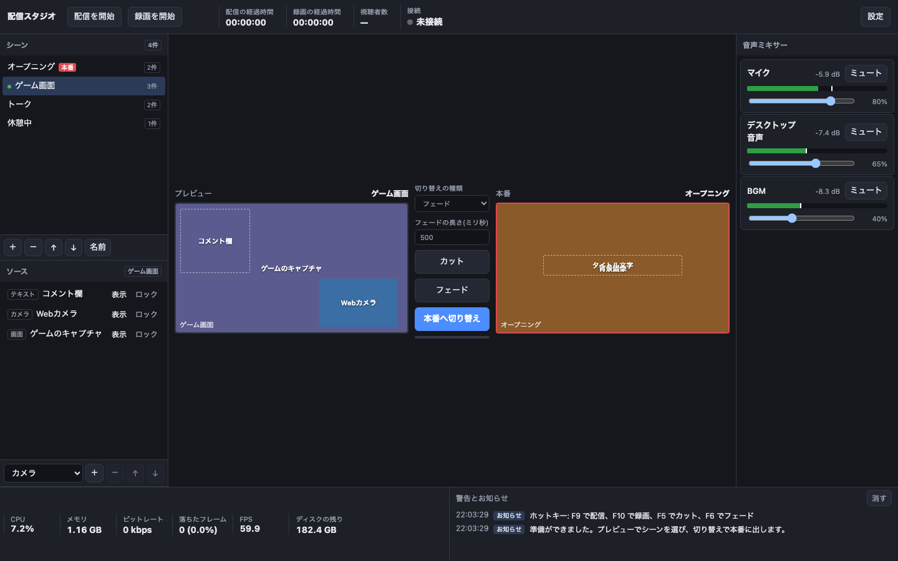
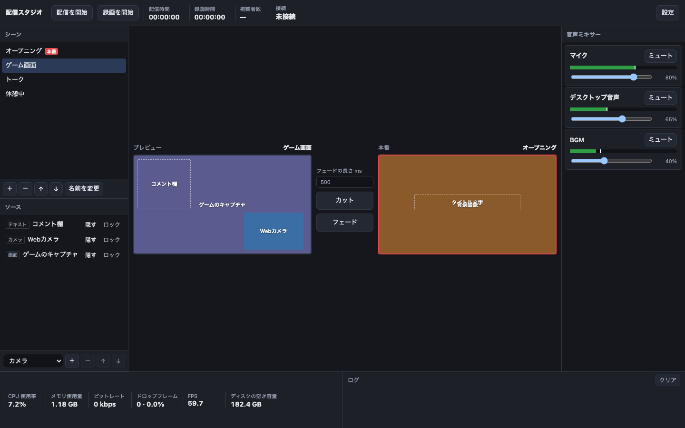

# plain-ja

plain-ja は、AI が書いた日本語を、ふつうの言葉で、用途に合った量に直す Claude Code / Codex のスキルです。

## 主な機能

| 機能 | 説明 |
|---|---|
| UI の文言の見直し | ボタン、ラベル、空の欄、エラーの文を直し、使われないボタンや、見れば分かる説明を外す |
| ドキュメントの見直し | README や使い方のページを、読み手と役割に合った構成と言葉にする |
| コミットと PR の文の見直し | 冗長な箇条書きを「困っていたこと → どうしたか」の短い文にする |
| スライドの文の見直し | 見出しとリード文を直し、削りすぎと、同じ形の表の繰り返しを防ぐ |
| 直す前と後の一覧 | 直したところと消した要素を、当てた決まりの番号と一緒に並べる |

同じ指示で AI に作らせたライブ配信の操作画面を、plain-ja で直すと次のように変わります。

| スキルなし | plain-ja で直した |
|---|---|
|  |  |

| | スキルなし | plain-ja で直した |
|---|---|---|
| ボタン | 39 | 37 |
| インジケーター | 37 | 22 |
| 画面の日本語 | 1,025 字 | 814 字 |

- 「切り替えの種類」の選択と「本番へ切り替え」のボタンを外した。どちらも「カット」「フェード」のボタンと役目が重なる
- シーンの件数、ミキサーの dB の数値、起動時の長い案内のように、見れば分かるものを外した
- ボタンの名前を、押したらどうなるかに合わせた:「表示」→「隠す」、「ミュート」→「ミュート / ミュート解除」
- 「配信の経過時間」→「配信時間」、「落ちたフレーム」→「ドロップフレーム」

ほかの直し方の例です。

| 場所 | 直す前 | 直したあと |
|---|---|---|
| 空の欄 | 図のタスクを押すと、ここにくわしく出ます | 図のタスクを選ぶと、詳細が表示されます |
| 状態 | うまくいきました | 成功 |
| ラベル | 使用中の時間 | 使用率 |
| スライドの見出し | ブランチ運用を理解しよう | ブランチ = 本流から分けて作業する線 |
| 表の列名 | 失敗 / なぜ困るか / どうするか | 失敗 / 困ること / 対策 |

## インストール方法

このリポジトリを、スキルのフォルダに置きます。

🟧 Claude Code

```bash
git clone https://github.com/asterisk3157/plain-ja ~/.claude/skills/plain-ja
```

⬛ Codex

```bash
git clone https://github.com/asterisk3157/plain-ja ~/.codex/skills/plain-ja
```

Claude Code か Codex を開き直し、「画面の日本語を直して」と頼んだときに plain-ja が読まれれば、使えています。

<details>
<summary>ほかのスキルとの使い分け</summary>

plain-ja は、UI やスライドのような短い文と、呼び名や何を書くかの決まりを受け持ちます。長い地の文の論理のつながりと冗長さは [yomiyasu](https://github.com/nanaism/yomiyasu) が受け持つので、両方を入れているときは、長い段落の仕上げだけを yomiyasu に任せます。

</details>

## ドキュメント

- 共通の決まりと進め方:[SKILL.md](SKILL.md)
- UI の文言:[references/ui.md](references/ui.md)
- README とドキュメント:[references/docs.md](references/docs.md)
- コミットメッセージと PR の本文:[references/commit.md](references/commit.md)
- スライドの文:[references/slides.md](references/slides.md)

## バージョン履歴

- v0.1.0:最初の公開

## ライセンス

MIT
